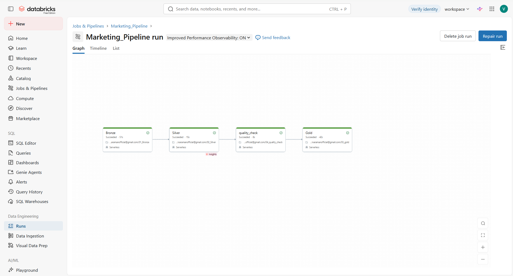
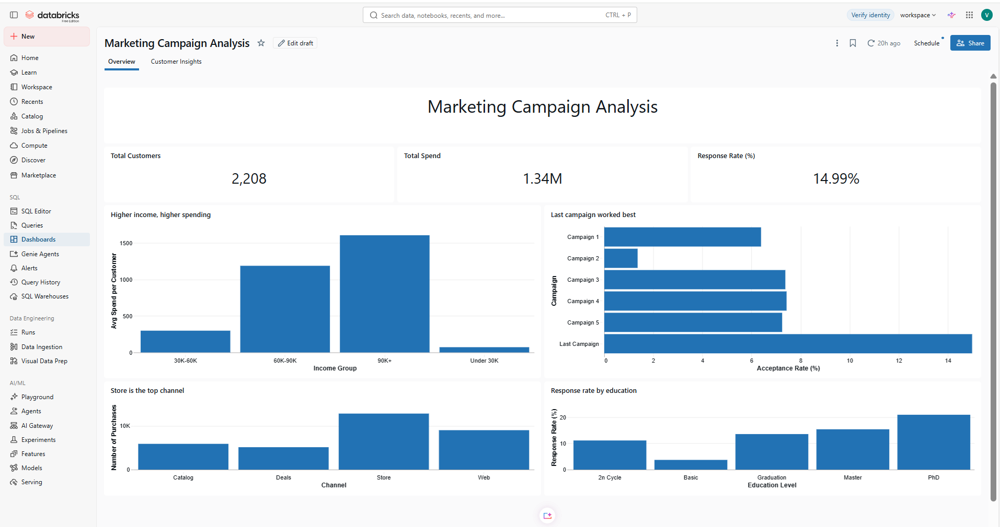
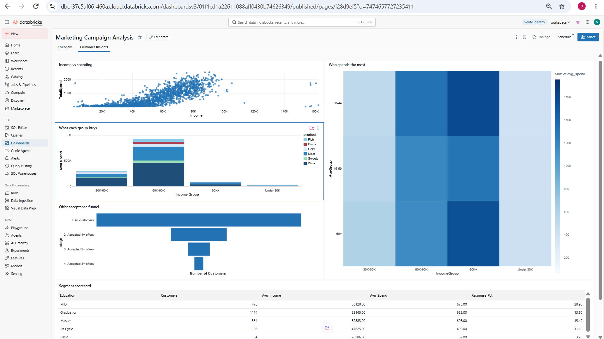

# Marketing Campaign Analysis: Databricks Data Pipeline

An end-to-end data pipeline built on **Databricks** using the **Bronze → Silver → Gold (medallion)** architecture. It processes the Kaggle *Customer Personality Analysis* dataset, validates the cleaned data, and presents the results in a published dashboard.

---

## Table of Contents
1. [Business Question](#business-question)
2. [Dataset](#dataset)
3. [Architecture](#architecture)
4. [Pipeline Stages](#pipeline-stages)
5. [Data Cleaning (Silver)](#data-cleaning-silver)
6. [Data Quality Checks](#data-quality-checks)
7. [Gold Tables](#gold-tables)
8. [Automation (Databricks Job)](#automation-databricks-job)
9. [Dashboard](#dashboard)
10. [Key Insights](#key-insights)
11. [Tech Stack](#tech-stack)
12. [How to Run](#how-to-run)
13. [Repository Structure](#repository-structure)
14. [Limitations](#limitations)
15. [Future Improvements](#future-improvements)

---

## Business Question
Which customers spend the most, and which campaigns and customer segments respond best to marketing offers?

## Dataset
- **Source:** Kaggle, *Customer Personality Analysis* (`marketing_campaign.csv`)
- **Format:** tab-separated (`\t`) CSV
- **Size:** about 2,240 rows (one row per customer)

| Column group | Example columns | Meaning |
|---|---|---|
| Customer profile | `Year_Birth`, `Education`, `Marital_Status`, `Income`, `Kidhome`, `Teenhome` | Age, education, income and family |
| Join date | `Dt_Customer` | Date the customer joined |
| Product spend | `MntWines`, `MntFruits`, `MntMeatProducts`, `MntFishProducts`, `MntSweetProducts`, `MntGoldProds` | Amount spent per product category (last 2 years) |
| Purchase channel | `NumWebPurchases`, `NumCatalogPurchases`, `NumStorePurchases`, `NumDealsPurchases` | Number of purchases per channel |
| Campaign response | `AcceptedCmp1` … `AcceptedCmp5`, `Response` | `1` = accepted the offer, `0` = did not accept. `Response` is the last (6th) campaign. |

## Architecture

```
Kaggle CSV → Unity Catalog Volume → Bronze → Silver → Quality Check → Gold → Dashboard
```

All tables are stored in the catalog/schema `marketing.default`.

## Pipeline Stages

| Stage | Notebook | Output | Description |
|---|---|---|---|
| Bronze | `01_Bronze` | `bronze_campaign` | Loads the raw tab-separated CSV from the Volume with no changes |
| Silver | `02_Silver` | `silver_campaign` | Cleans the data and adds derived columns |
| Quality check | `04_quality_check` | none | Validates Silver; fails the job if a check does not pass |
| Gold | `03_gold` | 8 `gold_by_*` tables | Builds business-ready summary tables for the dashboard |

## Data Cleaning (Silver)
- Removed duplicate rows
- Removed rows with missing `Income`
- Converted `Dt_Customer` to a proper date
- Removed unrealistic ages (age of 100 or more)
- Cleaned `Marital_Status`: removed invalid values (`Absurd`, `YOLO`) and grouped the rest into **Partnered** (Married, Together) and **Single** (Single, Alone, Divorced, Widow)
- Removed one extreme income outlier (income of 200,000 or more)
- Created new columns: `Age`, `AgeGroup`, `TotalSpend`, `TotalKids`, `IncomeGroup`, `JoinYear`
- **Result:** 2,208 clean rows (Partnered 1,428 / Single 780)

## Data Quality Checks
The `04_quality_check` notebook asserts that:
- Silver has more than 1,000 rows
- There are no null `Income` values
- `Marital_Status` contains only `Partnered` or `Single`
- There are no negative `TotalSpend` values

If any check fails, the task fails and **Gold does not run**, so bad data never reaches the dashboard.

## Gold Tables

| Table | Grain |
|---|---|
| `gold_by_education` | Customers, average spend, response rate per education level |
| `gold_by_age` | Same metrics per age group |
| `gold_by_marital` | Customers and average spend per marital group |
| `gold_by_product` | Total spend per product category |
| `gold_by_income` | Customers, average spend, response rate per income group |
| `gold_by_channel` | Total purchases per channel (Web, Catalog, Store, Deals) |
| `gold_by_campaign` | Acceptance rate per campaign |
| `gold_by_year` | Customers and total spend per join year |

Together with `bronze_campaign` and `silver_campaign`, this gives **10 tables** in `marketing.default`.

## Automation (Databricks Job)
A Databricks Job named **`Marketing_Pipeline`** runs the notebooks in order on **serverless compute**:

```
Bronze → Silver → quality_check → Gold
```

Each task starts only if the previous one succeeds. The job is run **manually** because the source is a fixed Kaggle file; rerun it after replacing the CSV.

## Dashboard
The published dashboard has two pages.

**Overview**
- KPI cards: total customers, total spend, response rate
- Average spend by income group
- Acceptance rate by campaign
- Purchases by channel
- Response rate by education

**Customer Insights**
- Income vs spending (scatter plot)
- Average spend by age and income group (heatmap)
- Spend by product and income group (stacked bar)
- Offer acceptance funnel
- Segment scorecard (table)

### Screenshots
Add your screenshots to a `screenshots/` folder and update the file names below.

| Pipeline run | Tables in Catalog |
|---|---|
|  |  |

| Dashboard: Overview | Dashboard: Customer Insights |
|---|---|
|  |  |

## Key Insights
1. **Size and response:** 2,208 customers, about 1.34M total spend, and a 14.99% response rate to the last campaign.
2. **Income drives spending:** average spend rises from about 72 (income under 30K) to about 1,600 (income 90K+).
3. **Campaigns:** the last campaign had the highest acceptance (about 15%); campaigns 1 to 5 ranged from about 1% to 7%.
4. **Education:** response rate rises with education, from 3.7% (Basic) to 20.9% (PhD). The Basic group has only 54 customers, so treat that figure with caution.
5. **Channels:** Store is the top purchase channel (about 12.8K), followed by Web (about 9.0K).
6. **Loyal responders:** only 96 customers accepted three or more offers, a small group worth targeting.

> These are observations from the data, not proof of cause. The dataset does not describe what each campaign offered.

## Tech Stack
- Databricks (Free Edition), Unity Catalog, Volumes
- PySpark and Spark SQL, Delta tables
- Databricks Jobs (serverless compute)
- Databricks AI/BI Dashboards

## How to Run
1. Download `marketing_campaign.csv` from Kaggle.
2. In Databricks, create the schema `marketing.default` and a Volume named `raw_data`, then upload the CSV.
3. Import the four notebooks from the `notebooks/` folder.
4. Check the file path in `01_Bronze`:
   `/Volumes/marketing/default/raw_data/marketing_campaign.csv`
5. Create a Job named `Marketing_Pipeline` with four notebook tasks on serverless compute and these dependencies:
   `Bronze → Silver → quality_check → Gold`
6. Click **Run now** and wait for all tasks to succeed.
7. Create the dashboard datasets with SQL queries on the `marketing.default.*` tables and build the charts.

## Repository Structure

```
.
├── README.md
├── notebooks/
│   ├── 01_Bronze.py
│   ├── 02_Silver.py
│   ├── 03_gold.py
│   └── 04_quality_check.py
└── screenshots/
    ├── job_run.png
    ├── tables.png
    ├── dashboard_overview.png
    └── dashboard_insights.png
```

The raw dataset is not included. Download it from Kaggle and check its license terms before sharing it.

## Limitations
- The data is a public sample dataset, not live company data.
- It records whether a customer accepted each campaign, but not what the campaign offered or when it ran.
- Spend covers only this shop, so it is much lower than total household income.
- `2n Cycle` (a European Master's-level degree) and `Master` are kept as separate education values, as provided in the dataset.

## Future Improvements
- Merge `2n Cycle` into `Master`
- Customer segmentation (for example, K-Means clustering)
- Connect a live data source and schedule the job
- Track campaign cost and ROI

## Author
Built as an internship project. 
By Sivaraman V
